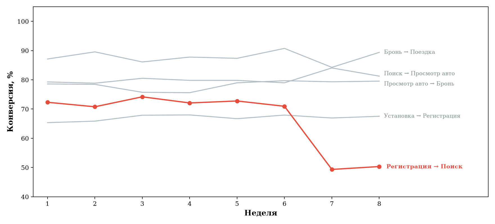

<h1>
  <a href="README.md"></a>
  <a href="README.ru.md"></a>
  МобиКар — анализ продуктовой воронки
</h1>

[↩ Прикладные проекты](https://github.com/levg00/levg00/blob/main/portfolio/applied.ru.md)

Анализ клиентского пути от установки приложения до первой поездки, выявление проблемного перехода и гипотез для восстановления конверсии.

Кейс в рамках отбора на стажировку в **Т-Банк**.

#### 📓 [Код и расчёты](notebooks/funnel-analysis.ipynb) · 📄 [Решение](materials/report.ru.pdf)

## 🎯 Задача

По данным за восемь недель определить, на каком этапе воронки снизилась конверсия, показать проблему на одном графике и предложить дальнейшие проверки.

**Контекст задания:** изменился поиск авто, установки выросли. Доля зарегистрированных пользователей, возвращающихся в приложение через неделю, не изменилась, отзывы не ухудшились.

📋 [Полное условие кейса](materials/task.ru.md)

## ⚡ Что сделал и какие инструменты использовал

- **Python / pandas:** рассчитал конверсии пяти переходов и всей воронки, сравнил их динамику по неделям.
- **Matplotlib:** построил график и выделил проблемный этап цветом.
- **Продуктовый анализ:** сформулировал гипотезы о причинах падения и предложил план проверки.

## 📉 Результат анализа

**Переход «Регистрация → Поиск» просел на 21,60 п. п. между шестой и седьмой неделями.** Его стоит исследовать в первую очередь.

[](notebooks/funnel-analysis.ipynb)

| Показатель | Неделя 6 | Неделя 7 | Изменение |
| :--- | :--- | :--- | :--- |
| Регистрация → Поиск | 70,95% | 49,35% | −21,60 п. п. |
| Установка → Первая поездка | 27,48% | 18,54% | −8,94 п. п. |

Наблюдаем наибольшее падение между 6 и 7 неделями, выдвинем гипотезы этого изменения.

## 💡 Гипотезы и план проверки

| Гипотеза | Что проверить |
| :--- | :--- |
| Интерфейс поиска стал менее понятным | Действия после регистрации, путь до поиска и обратную связь пользователей |
| Ухудшилась работа поиска | Ошибки и технические сбои |
| Появились дополнительные барьеры | Путь до поиска и различия между городами, устройствами и версиями приложения |

Дополнительно, **A/B-тест** для проверки влияния изменений поиска.

<details>
<summary><b>⚙️ Как рассчитана конверсия</b></summary>

**Конверсия за день = дошедшие до следующего этапа / пользователи предыдущего этапа × 100%.**

Для графика взял среднее дневных значений за каждую неделю.

**Дополнительная проверка:** пересчёт по общему числу пользователей за неделю тоже показал падение на переходе к поиску. Сравнение двух способов есть в [notebook](notebooks/funnel-analysis.ipynb).

</details>

<details>
<summary><b>📁 Какие данные использованы</b></summary>

- **56 дней, восемь недель:** установки, регистрации, поиск, просмотр авто, бронирования и первые поездки.
- **CSV и Excel:** одинаковые данные, восстановленные из сохранённого блока чисел. Расчёты совпали с исходным notebook. [Подробнее о данных](data/README.md).

</details>

## 📂 Материалы

- [Код, расчёты и график — Jupyter Notebook](notebooks/funnel-analysis.ipynb).
- [График и выводы на одной странице — PDF](materials/report.ru.pdf).
- [Условие кейса](materials/task.ru.md).
- [Данные CSV](data/funnel-daily.csv) · [Данные Excel](data/funnel-data.xlsx).

<details>
<summary><b>Файлы</b></summary>

```text
README.md                        — описание на английском
README.ru.md                     — описание на русском
notebooks/funnel-analysis.ipynb   — код и расчёты
data/funnel-daily.csv             — дневные данные
data/funnel-data.xlsx             — те же данные в Excel
data/README.md                    — происхождение данных
assets/funnel.ru.png              — график конверсий
materials/task.ru.md              — условие кейса
materials/report.ru.pdf           — исходный график и выводы
materials/original-analysis.ipynb — исходный notebook
requirements.txt                 — зависимости
```

</details>
